# SchoolbusRFID — Location-Based Child Drop-off Tagging Application

🇰🇷 [한국어](README.md) · 🇬🇧 English

> An undergraduate team project that tried to solve the problem of children being left behind in school buses with a system that *"tracks boarding and alighting precisely with RFID tags and shares commute information in real time with parents, teachers, and the driver."* Carried out by a 4-person team in the 2024 Fall course *"Design and Project Fundamentals II"* (reverse-engineering final presentation) in the Department of Medical IT Engineering — my first attempt at a **hardware + mobile + cloud 3-tier full stack**.

     

---

## ⚠ About the Build Status

This repository **preserves the code exactly as it was at the September 2024 demo**. Unlike [MedQueue](https://github.com/MoriochoRadio/MedQueue) (no longer buildable due to the end of Xamarin support), SchoolbusRFID was written on an up-to-date 2024 stack (Gradle 8.7, AGP 8.6.0, compileSdk 34, Firebase 21.x) and was buildable at the time of writing.

However, future buildability may change for the following reasons:
- Firebase dependencies recommend migration to 22+
- Google Play Services / Android SDK deprecation policies
- The point at which `compileSdk 34` is no longer current

All secrets in the code (Firebase Auth Secret, WiFi credentials, Google Maps API key, `google-services.json`) have been replaced with masked dummies, and the original credentials have been revoked and invalidated from the Firebase console. To build it yourself, you need to fill in `google-services.json.example` in [`src/android/`](src/android/), the Maps key placeholder in `AndroidManifest.xml`, and the WiFi/Firebase placeholders in `src/firmware/*.ino` with values for your own environment.

---

## 📚 Project Context

| Item | Details |
|---|---|
| **Period** | 2024 Fall semester (presentation date: 2024-09-24) |
| **Affiliation** | Dept. of Medical IT Engineering, Konyang University |
| **Course** | Design and Project Fundamentals II (reverse-engineering final presentation) |
| **Advisors** | Professors ◯◯◯ · ◯◯◯ |
| **Team** | Team 2 (4 members) — PM ◯◯◯ · Fabrication ◯◯◯ · ENG **Kim TaeKyoung (me)** · ENG ◯◯◯ |
| **My (KimTaeKyoung) role** | **ENG — main owner of the Android app's backend logic** + presentation slide support |
| **My lead area** | Backend (behavior) logic of `MainActivity` / `activity_driver_*` / `activity_teacher_*` / `activity_parent_*` / `OperationStartActivity` / `ParentsActivity` |
| **Shared work** | UI / layout XML / `MapActivity` / `ParentsMapActivity` / Firebase integration |

---

## ❓ Problem Definition

> *"There was a safety bell and an accompanying guardian, and yet… a 3-year-old was trapped in a school bus for an hour"*
> — Daejeon Ilbo, 2022.08.11

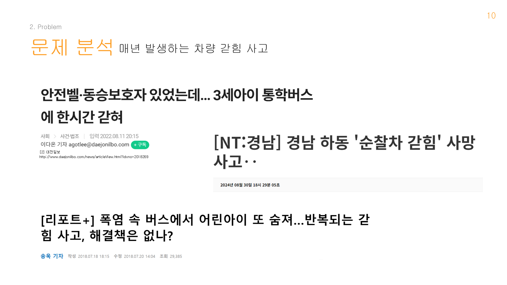

School-bus entrapment accidents recur every year. Quoting the problem analysis from our presentation slides:

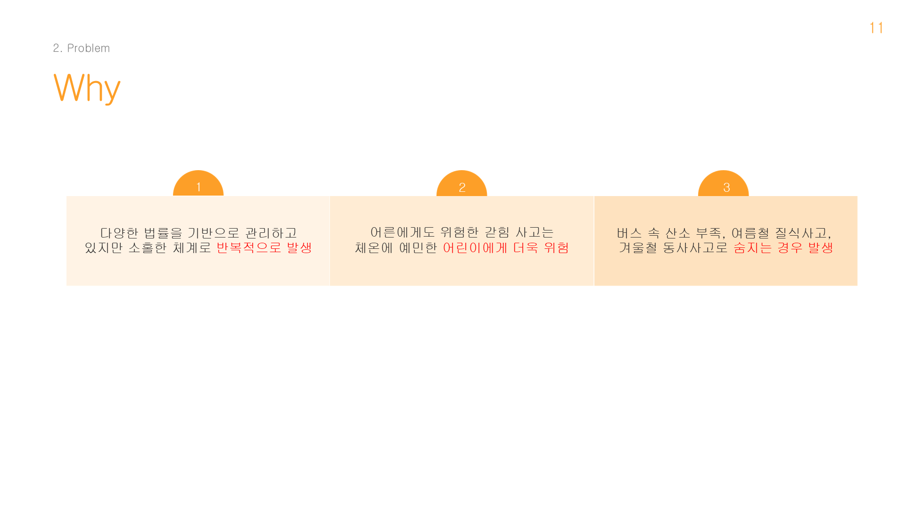

1. **Managed under a variety of laws, yet accidents keep recurring due to a lax system**
2. **Entrapment, dangerous even for adults, is even more dangerous for children who are sensitive to body temperature**
3. **Deaths occur from oxygen shortage inside the bus, suffocation in summer, and hypothermia in winter**

Even with existing safety devices (safety bells, accompanying guardians), accidents keep happening. We concluded the root cause is that *"there is no accurate count at the moment of boarding and alighting,"* and tried to solve that with RFID tag counting.

---

## 💡 Solution

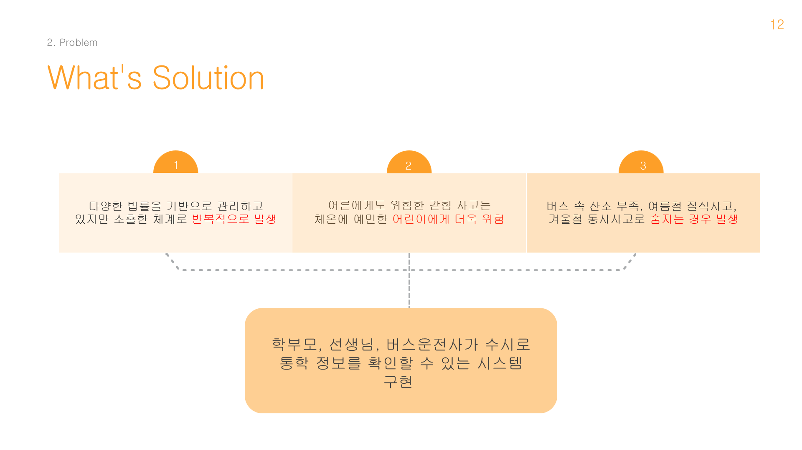

> **"Implement a system where parents, teachers, and the bus driver can check commute information at any time"**

The core is showing all three roles, in real time, *"who is on the bus right now"* and *"where the bus is right now."* Parents can directly confirm *"whether my child boarded / got off safely."*

---

## 🛠️ Tech Stack

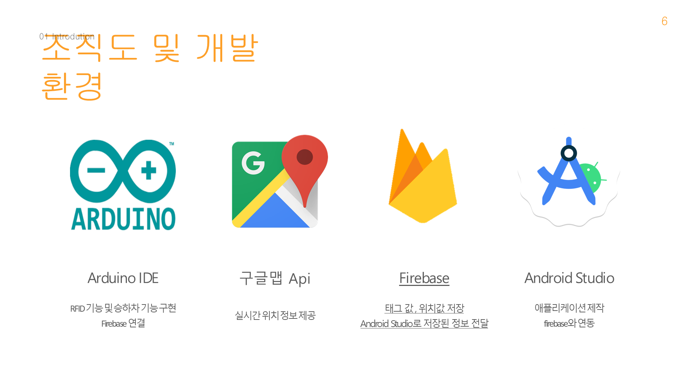

| Area | Technology |
|---|---|
| **Mobile** | Android Native (Java) · Gradle 8.7 · AGP 8.6.0 · compileSdk 34 · minSdk 24 |
| **Firmware** | Arduino C++ · ESP8266 (NodeMCU pinmap) |
| **RFID reader** | MFRC522 (Miguel Balboa library) |
| **Backend** | Firebase Realtime DB · Firebase Auth |
| **Maps** | Google Maps Android API · Google Play Services Location |
| **Dev environment** | Android Studio · Arduino IDE · Visual Studio Code |

**Key dependencies** (`src/android/app/build.gradle`):
- `firebase-database 21.0.0`, `firebase-auth 21.1.0`
- `play-services-maps 18.0.2`, `play-services-location 21.0.1`
- `MFRC522`, `FirebaseESP8266` (Mobizt), `ArduinoJson` (firmware)

---

## 🤔 Why We Built It This Way — Technology Choice Q&A

**Q. Why RFID?**
Because we defined the cause of entrapment accidents as *"no accurate count at the moment of boarding and alighting,"* RFID — where **one tag = one boarding/alighting event** — solves the problem most directly. A child only has to touch a card to the reader; there is no burden like installing or operating an app. The references also cite research on deep-learning-based boarding authentication ([5]), but this project chose the simple and reliable discrete-event approach of tagging.

**Q. Why the driver / teacher / parent 3-role structure?**
The solution definition itself was *"parents, teachers, and the bus driver check commute information at any time,"* and the three roles need different information — the driver needs trip start and passenger count, the teacher needs boarding/alighting counts and the decision to end the trip, and parents need their child's boarding status and the bus location. So `MainActivity` branches into 3 roles, separating login and screens per role.

**Q. Why Firebase Realtime DB?**
A single tag has to be reflected simultaneously on the driver's, teacher's, and parents' screens — a multi-device real-time problem — so the Realtime DB with its listener-subscription synchronization was the right fit. Since the ESP8266 writes directly to `/tag` via the `FirebaseESP8266` library without a server, the 3-tier is complete without building a separate backend server. It is also a reuse of the real-time synchronization pattern learned in [MedQueue](https://github.com/MoriochoRadio/MedQueue) the previous semester.

**Q. Why Google Maps?**
Because the parents' need was not only *"did my child board"* but also *"where is the bus right now."* The latitude/longitude in `/DriverLocation` is laid directly onto the map in `ParentsMapActivity`, using the Google Maps Android API + Play Services Location, which integrate easily with native Android.

**Q. Why ESP8266?**
Because it is a board with built-in WiFi, a single board can handle both the RFID reader (MFRC522, connected via SPI) and the cloud upload, and the `FirebaseESP8266` library lets it write directly to Firebase without an intermediate server.

---

## 🏗️ System Design

The distinguishing point of this project is the **3-tier full stack of hardware + mobile + cloud**. The full flow from the RFID reader to the parents' screen:

```
┌──────────────┐         ┌─────────────────┐         ┌─────────────────────┐
│  RFID card   │ ─SPI─▶ │  ESP8266 +      │ ─HTTP─▶│  Firebase           │
│  (student)   │         │  MFRC522 RFID   │         │  Realtime DB        │
└──────────────┘         │  + WiFi         │         │                     │
                          └─────────────────┘         │  /tag/{uid}/        │
                                                       │   {boarding}        │
┌──────────────┐         ┌─────────────────┐         │  /DriverLocation/   │
│  Bus GPS     │ ───────▶│  Android        │ ─SDK─▶ │   {latitude,        │
│  (real-time) │         │  MapActivity    │         │    longitude}       │
└──────────────┘         │  (driver view)  │         └──────────┬──────────┘
                          └─────────────────┘                    │
                                                                 │ subscribe
                                          ┌──────────────────────┼────────┐
                                          ▼                      ▼        ▼
                                  ┌──────────────┐    ┌──────────────┐  ┌──────────────┐
                                  │ Operation    │    │ Parents      │  │ ParentsMap   │
                                  │ StartActivity│    │ Activity     │  │ Activity     │
                                  │ (teacher)    │    │ (parents)    │  │ (parents)    │
                                  │ boarding/    │    │ child        │  │ bus location │
                                  │ alighting    │    │ boarding     │  │ map          │
                                  │ counts       │    │ status       │  │              │
                                  └──────────────┘    └──────────────┘  └──────────────┘
```

### System Structure
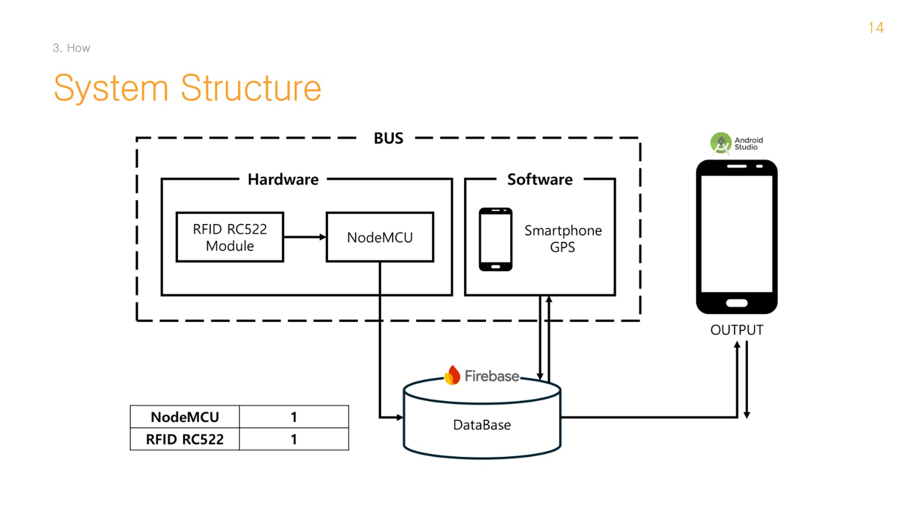

### System Architecture
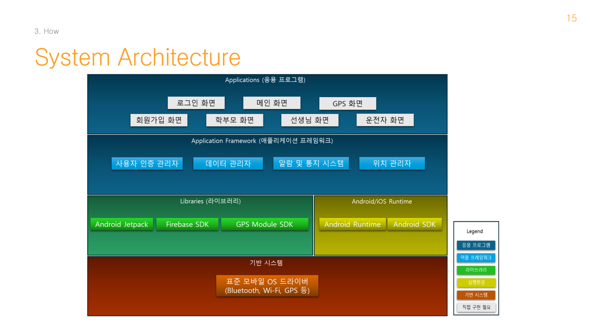

### Flow Chart
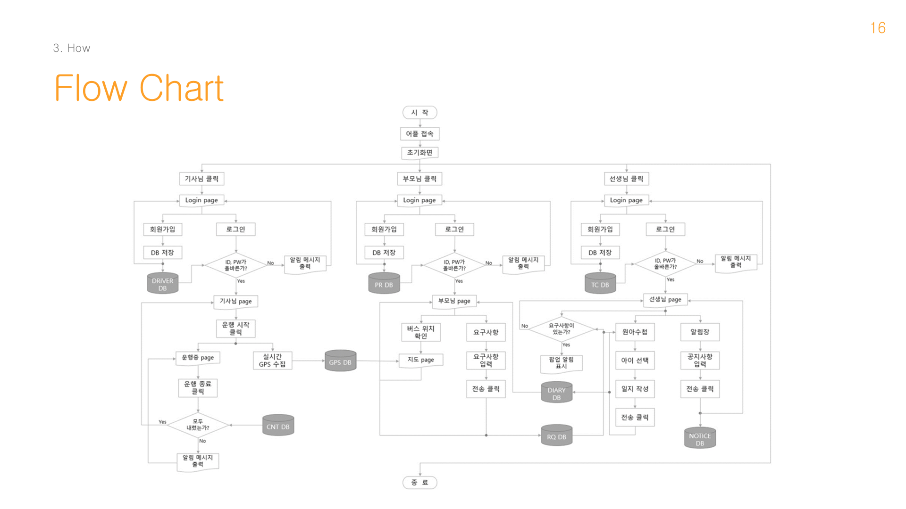

---

## ✨ Key Features

### Usage scenario (4 steps)

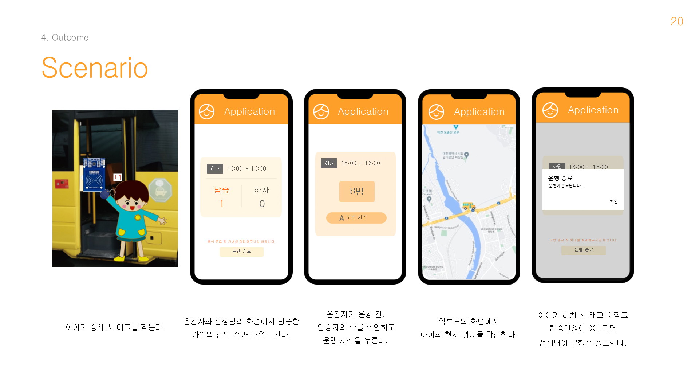

1. **Before departure, the driver checks the number of passengers and presses trip start**
2. **A child tags their card when boarding** → the headcount increments on the driver's and teacher's screens
3. **Parents check their child's current location on their own screen**
4. **A child tags when alighting; when the passenger count reaches 0, the teacher ends the trip**

### UI — 3-role branching

| | |
|---|---|
| **Main ↔ Login (entry point for 3 roles)** | **Driver screen ↔ Teacher screen** |
| 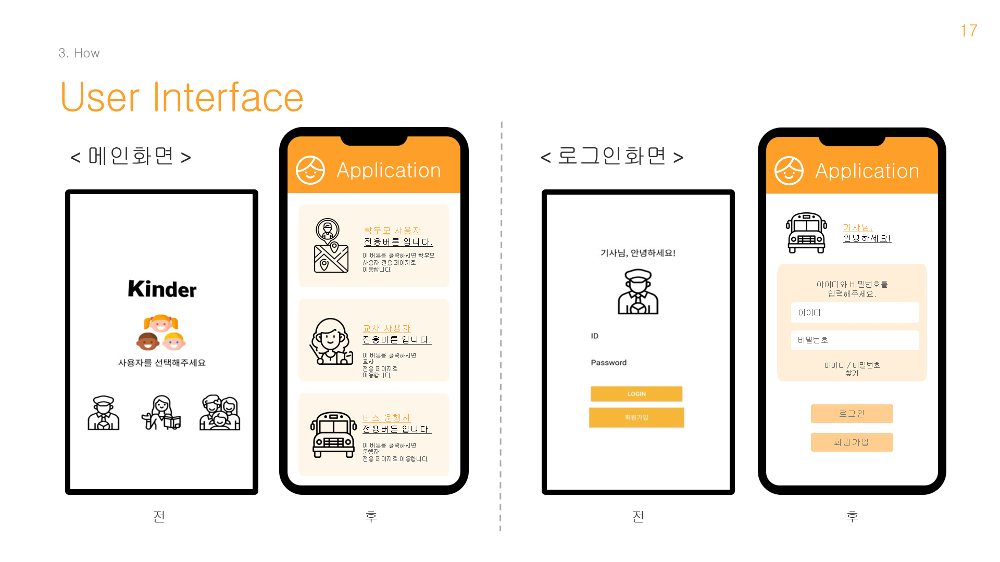 | 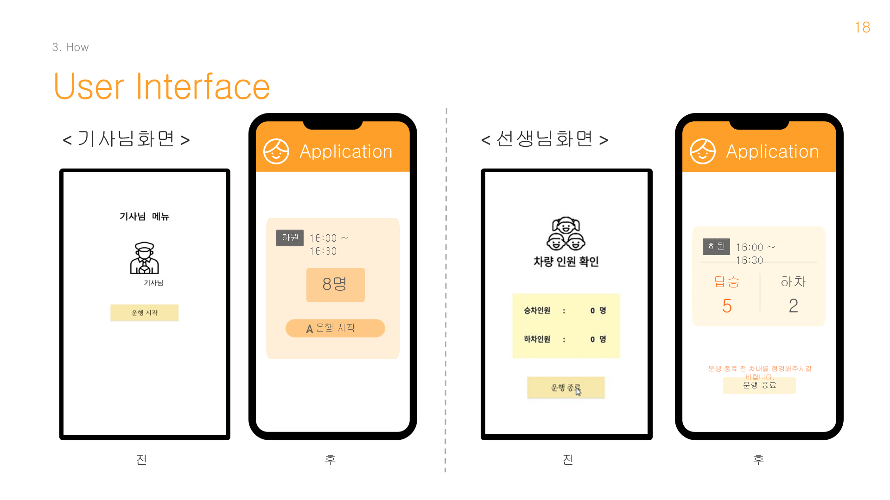 |

### Demo video

<video src="assets/videos/software_demo.mp4" poster="assets/videos/software_demo_poster.png" controls width="800"></video>

> If the video above does not display, play [`assets/videos/software_demo.mp4`](assets/videos/software_demo.mp4) directly (23 MB, 1:28).

Additional demo: [`software_execution.mov`](assets/videos/software_execution.mov) (3.8 MB, 0:48 — portrait mobile screen recording)

---

## 👤 My Contribution (KimTaeKyoung · ENG)

Since this was a team project, I clearly separate the parts I owned and wrote myself from the parts we worked on together.

### 1) Main owner of the Android backend logic

I was the main owner of the **behavior logic (event handlers · state transitions · Firebase calls · input validation)** of the following 10 .java files:

```
src/android/app/src/main/java/com/example/project01/
├── MainActivity.java              (3-role branching entry point)
├── activity_driver_login.java
├── activity_driver_join.java
├── activity_driver_main.java
├── activity_teacher_login.java
├── activity_teacher_join.java
├── activity_parent_login.java
├── activity_parent_join.java
├── OperationStartActivity.java    (teacher screen — boarding/alighting counts)
└── ParentsActivity.java           (parents screen — child status)
```

**Shared work** (done together with the team): all layout XML, `MapActivity.java` / `ParentsMapActivity.java` (maps), initial Firebase integration setup.

### 2) Code that did not change by a single byte across 5 snapshots

The `docs/_archive/iterations/` folder in this repo preserves 5 stages of code snapshots from the semester. Some of the files I owned are **bit-identical across all 5 snapshots** — written once early in the semester and never needing another touch:

| File | p00 | p01 | p02 | p03 | p04 | Result |
|---|---|---|---|---|---|---|
| **MainActivity.java** | 1670 B | = | = | = | = | ★ **Bit-identical across all 5 snapshots** (`68ce8336`) |
| activity_driver_join.java | 3015 B | = | = | = | = | Identical across all 5 |
| activity_teacher_join.java | 3027 B | = | = | = | = | Identical across all 5 |

In contrast, the files I grew incrementally:

| File | p00 (initial) | p01 → p04 (growth) |
|---|---|---|
| OperationStartActivity.java | 1477 B (stub) | 3836 → 5685 B |
| ParentsActivity.java | 969 B (stub) | 4844 → 5447 B (5× growth) |

> For the full time-series evolution matrix of 13 files × 5 snapshots, see [`docs/_archive/iterations/README.md`](docs/_archive/iterations/README.md).

### 3) Backend logic worked out through Korean domain comments

The files I owned are rich in Korean comments (`OperationStartActivity.java` alone has 20). Traces of spelling out the domain meaning in my own words (comments translated to English below):

```java
// MainActivity.java — 3-role branching (identical code across all 5 snapshots)
// Parent
// Teacher
// Driver

// OperationStartActivity.java:70-91 — Firebase real-time sync
tagRef.addValueEventListener(new ValueEventListener() {
    @Override
    public void onDataChange(DataSnapshot dataSnapshot) {
        // Reset the boarding and alighting counts
        boardingCount = 0;
        alightingCount = 0;
        for (DataSnapshot tagSnapshot : dataSnapshot.getChildren()) {
            Boolean boarding = tagSnapshot.child("boarding").getValue(Boolean.class);
            if (boarding != null && boarding) {
                boardingCount++;      // student who boarded
            } else if (boarding != null && !boarding) {
                alightingCount++;     // student who alighted
            }
        }
        // Reflect the updated values in the UI
        boardingCountTextView.setText(String.valueOf(boardingCount));
        alightingCountTextView.setText(String.valueOf(alightingCount));
    }
});
```

```java
// OperationStartActivity.java:104-105 — the domain safety message embedded directly in the dialog
// (translation: title "End trip", message "Passengers still remain.\nPlease check once more")
setTitle("운행 종료")
    .setMessage("탑승자가 남아있습니다.\n다시 한 번 확인해주세요");
```

```java
// ParentsActivity.java — child info exposed directly in the Korean UI
// (translation: "<name> (child)" and boarding status "boarded" / "not boarded")
childNameTextView.setText(sname + " 어린이");
boardingStatusTextView.setText(boarding ? "탑승" : "미탑승");
```

---

## 📅 Project Schedule

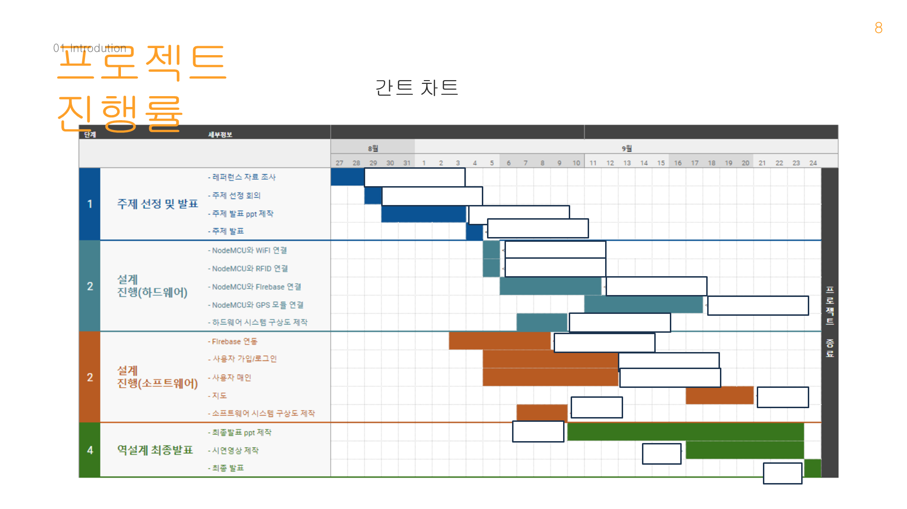

Semester Gantt chart. Within a single semester we completed the 3-tier system of **hardware (RFID + ESP8266) + mobile (Android 3-role) + cloud (Firebase + Maps)**.

---

## 🎯 Expected Effects

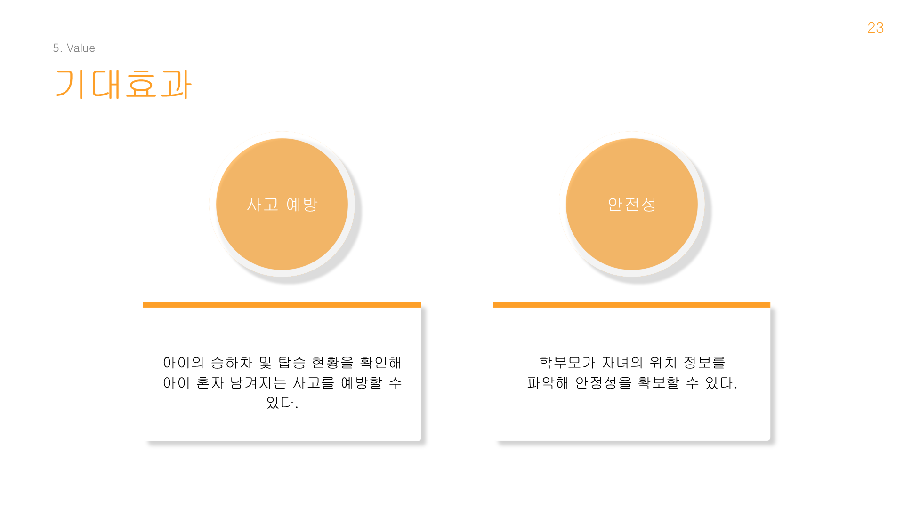

- **Safety**: parents can track their child's location information, securing peace of mind.
- **Accident prevention**: by checking children's boarding/alighting and occupancy status, accidents where a child is left alone can be prevented.

---

## ✍️ Code That Keeps My Own Voice

The code in this repo is not a *polished final product* — it is the raw trail left by *undergraduate sophomores touching RFID hardware + Firebase + a multi-device app for the first time*. Things deliberately left unpolished:

### 1) The first library-name typo from early in the semester

```cpp
// src/firmware/_archive/RFID.ino:12
#include <MFRC552.h>    // ← the correct library is MFRC522
```

A trace of misspelling one character of the library name in the first RFID spike early in the semester (`MFRC522` ↔ `MFRC552`). Subsequent `.ino` files corrected it, and this file was preserved as evidence of learning authenticity.

### 2) The `*****설정필요*****` ("configuration needed") placeholders

```cpp
// src/firmware/_archive/Firebase_WIFI.ino:14-17
#define FIREBASE_HOST "*********설정필요*********"
#define FIREBASE_AUTH "*********설정필요*********"
#define WIFI_SSID     "*********설정필요*********"
#define WIFI_PASSWORD "*********설정필요*********"
```

Placeholders I embedded while making the Firebase integration guide so I would not forget *"this needs filling in"* (the Korean string `설정필요` means "configuration needed"). Subsequent `.ino` files evolved by filling in the actual values.

### 3) The demo dummy value `alightingCount = 6`

```java
// src/android/app/src/main/java/com/example/project01/OperationStartActivity.java:122-124
btnReset.setOnClickListener(new View.OnClickListener() {
    @Override
    public void onClick(View view) {
        // Reset the current values
        boardingCount = 0;
        alightingCount = 6;   // ← no explanation in the code for why 6 (presumed demo dummy)
        ...
```

Pressing the reset button initializes `alightingCount = 6`, and the code has no explanation for *why 6*. Presumably a dummy value planted arbitrarily to make the presentation demo look like *"a state not yet cleaned up from a moment ago"* — an honest undergraduate demo trace.

### 4) The empty file created but never used

```
src/android/app/src/main/java/com/example/project01/activity_join_login.java   (0 bytes)
```

The same `d41d8cd9` MD5 (= empty file) across all 5 snapshots. A trace of deciding only on the name early in the semester and leaving it empty as the flow changed.

### 5) The typo caught and fixed just before the presentation

A typo found in the manifest inside `docs/_archive/iterations/project03.zip`:

```xml
<!-- inside project03.zip -->
<activity android:name=".PartentsMapActivity" ... />
                       ^^^^^^^^ ← Partents (sic)

<!-- corrected in project04 (= src/android/) -->
<activity android:name=".ParentsMapActivity" ... />
```

Someone caught and fixed it just before the presentation. I do not clearly remember whether it was me or another teammate who corrected it — but *the time-series archive preserves the correction itself*. The value of a time series lies not in preserving only the result, but in preserving *the path to the result*.

### 6) The manifest with the same line written twice

```xml
<!-- src/android/app/src/main/AndroidManifest.xml:18-23 -->
<activity android:name=".ParentsMapActivity" android:exported="false" />
<activity android:name=".ParentsMapActivity" android:exported="false" /> <!-- MapActivity 등록 -->
```

The typo from 5) above was corrected, but the line itself was never deleted, so the same activity is registered twice. The comment on the second registration (`<!-- MapActivity 등록 -->`, "MapActivity registration") shows it was *"a slot originally meant for a different name."* A trace of last-minute code integration.

### 7) Traces of downloading from the Firebase console multiple times

```
src/android/app/src/google-services (3).json.example
                                  ^^^ ← the 3rd copy downloaded from the Firebase console
```

The filename itself is a learning trace — a mark left by repeatedly downloading and dragging `google-services.json` from the Firebase console, with the ` (3)` suffix still attached when the copy was dropped into the src/ folder.

---

## 📂 Archive

| Material | Path | Notes |
|---|---|---|
| 🎤 Final presentation | [`docs/presentation_final_redacted.pptx`](docs/presentation_final_redacted.pptx) | 26 slides (teammate and professor names masked) |
| 🎬 Demo video (main) | [`assets/videos/software_demo.mp4`](assets/videos/software_demo.mp4) | 1:28 / 1920×1080 |
| 🎬 Demo video (execution) | [`assets/videos/software_execution.mov`](assets/videos/software_execution.mov) | 0:48 / portrait screen recording |
| 📦 Time-series code snapshots | [`docs/_archive/iterations/`](docs/_archive/iterations/) | project00~03 (4 snapshots) + README |
| 🔌 Firmware guide | [`src/firmware/README.md`](src/firmware/README.md) | ESP8266 pinmap + library installation |

> 📌 The names of the 3 teammates and 2 professors other than me have been masked as `◯◯◯` in the body and metadata of the presentation materials. Teammates' PC account names have also been removed from the `iterations/` archives; who used which PC is recorded only as `<PC_X>` / *by role* in `iterations/README.md`.

---

## 📚 References (cited in the presentation)

Materials cited by this project:

| # | Source |
|---|---|
| [1] | (2021-1) Advanced Design and Project I, Team 6, *Smart boarding/alighting management and childcare journal system* (preceding capstone) |
| [2] | Lee Da-on, *There was a safety bell and an accompanying guardian, and yet… a 3-year-old was trapped in a school bus for an hour*, Daejeon Ilbo, 2022.08.11 |
| [3] | Kang Min-su, *Repeated school-bus entrapment accidents — why do they keep happening?*, Aju Business Daily, 2018.07.22 |
| [4] | Song Wook, *Another young child dies in a bus in a heat wave — recurring entrapment accidents, is there no solution?*, SBS News, 2018.07.20 |
| [5] | Moon Hyung-jin, *Design of a safe boarding and alighting system for children's buses using deep-learning-based user authentication*, Journal of Convergence for Information Technology, 2020 |
| [6] | Lee Seung-jae et al. (8 authors), *A study on preventing safety accidents in children's transport vehicles*, Proceedings of the KAIS Fall Conference, 2023 |

---

## ✍️ Retrospective

We took the real safety problem of children trapped in school buses and explored the hypothesis: *"can it be solved by tracking boarding and alighting precisely with RFID tags?"*

The traces of our 4-person team building across 5 PCs over one semester remain intact in the time-series archive at [`docs/_archive/iterations/`](docs/_archive/iterations/), and I even switched my own PC once mid-semester (`neo62` → `Tkkim`). The other teammates each built the same codebase on their own PCs, and those traces were embedded in the `local.properties` of the 5 snapshot stages (now sanitized for security — teammates' PCs other than mine are preserved only as `<PC_X>` mapping information).

Within that, I was the main owner of the **Android backend logic** — the login, main, and trip-start screens for the three roles of parent / teacher / driver — while the UI, maps, and Firebase integration were built together with the team. That the `MainActivity.java` I wrote at the start of the semester went through 5 snapshots **without a single byte changing** is a small point of pride, but the `PartentsMapActivity` typo that went uncaught until just before the presentation, still sitting inside project03 in the same manifest, is a trace of the same semester too.

The Firebase real-time synchronization pattern learned in [`MedQueue`](https://github.com/MoriochoRadio/MedQueue) (2024 Spring semester, *patient queue monitoring*) became the foundation of this project's *"tag → count → parent notification"* flow. At the learning stage I had only touched student-info CRUD in [`study-windows-programming/022_FireBase`](https://github.com/MoriochoRadio/study-windows-programming); that expanded into a *"real-time patient queue"* in MedQueue, and expanded once more into *"real-time child safety monitoring"* in SchoolbusRFID.

This project was also my first hands-on experience with a **3-tier full stack of hardware (ESP8266 + MFRC522) + mobile (Android 3-role) + cloud (Firebase Realtime DB + Maps)**. That experience later expanded the care domain into [`ElderCaringApp`](https://github.com/MoriochoRadio/ElderCaringApp)'s *"elder care monitoring"* and became the foundation for team collaboration in the [`seed-project`](https://github.com/MoriochoRadio/seed-project) capstone.

---

## 🗂️ Related Repositories

### The foundational learning that made this project possible
- [`study-java`](https://github.com/MoriochoRadio/study-java) — OOP / event handlers / anonymous classes in Android Java
- [`study-windows-programming`](https://github.com/MoriochoRadio/study-windows-programming) — first exposure to Firebase Realtime DB (`022_FireBase` chapter)

### Sibling projects in the same healthcare/care domain
- [`MedQueue`](https://github.com/MoriochoRadio/MedQueue) — *patient queue monitoring* (Xamarin.Forms · 2024-1)
- [`ElderCaringApp`](https://github.com/MoriochoRadio/ElderCaringApp) — *elder care monitoring*

### The medical + AI projects that followed
- [`AI_Lung_1`](https://github.com/MoriochoRadio/AI_Lung_1) — lung medical imaging AI
- [`sperm-ai`](https://github.com/MoriochoRadio/sperm-ai) — AI sperm motility analysis
- [`seed-project`](https://github.com/MoriochoRadio/seed-project) — capstone (in progress)

---

## License

See [`LICENSE.md`](LICENSE.md). This repository publishes the learning outcomes of an undergraduate team project for portfolio purposes; commercial use requires team agreement.

---

*Author: [MoriochoRadio](https://github.com/MoriochoRadio) (KimTaeKyoung) · Dept. of Medical IT Engineering, Konyang University*
